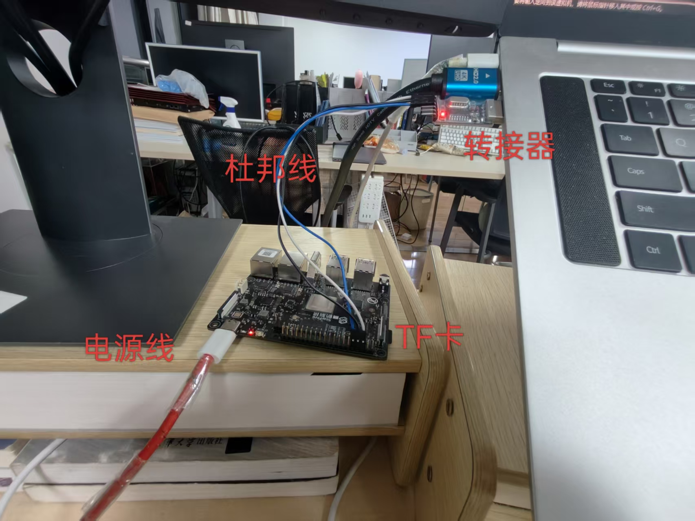
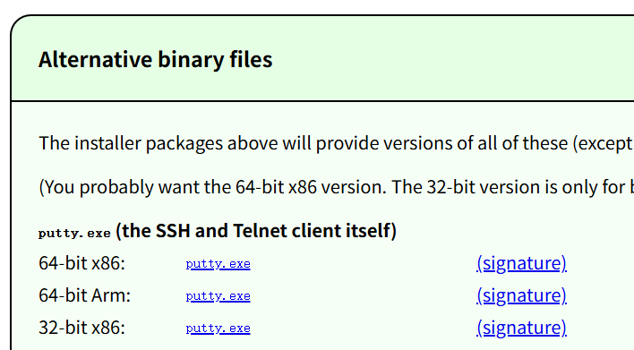
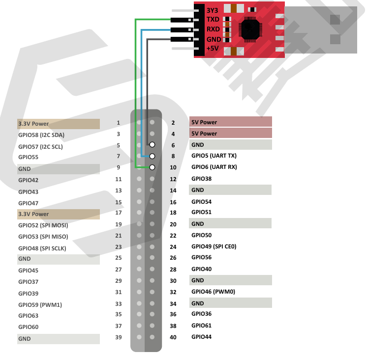
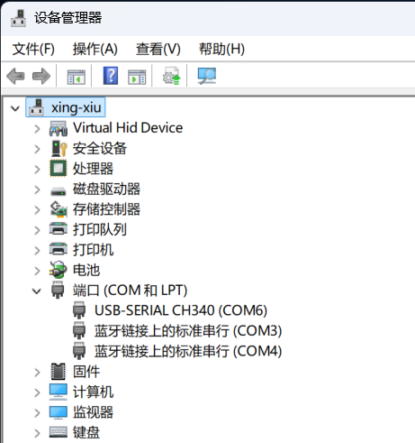
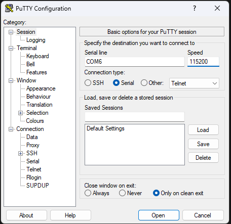
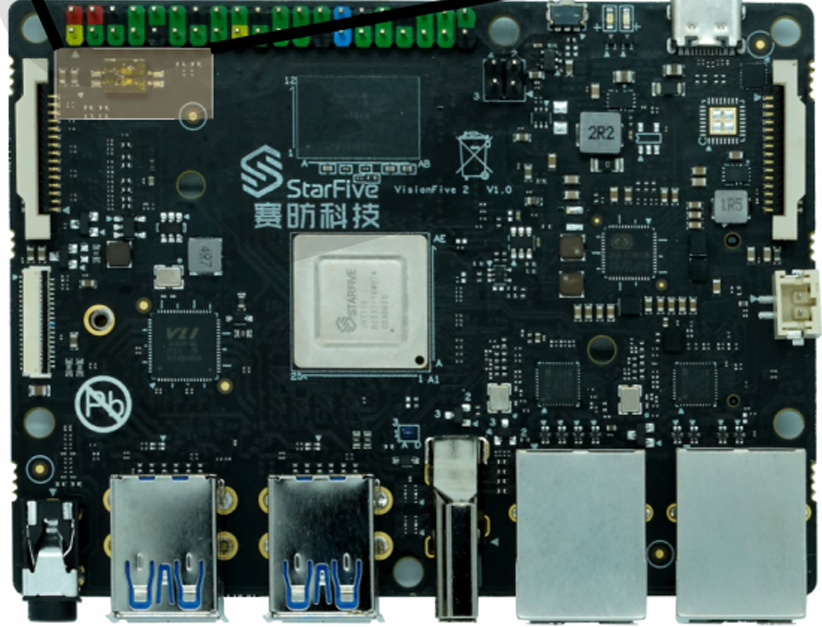
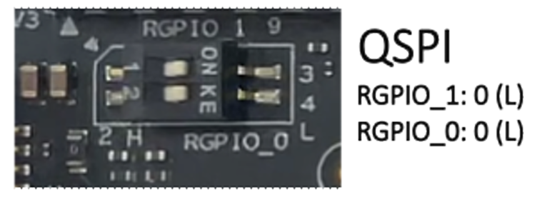
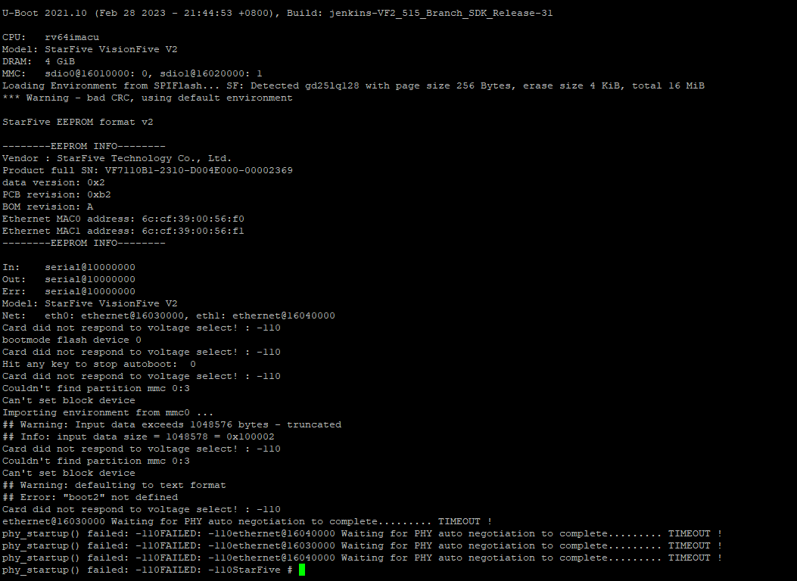
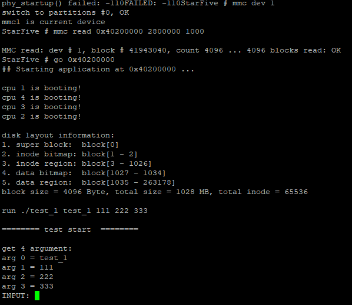

# lab-10: 从虚拟QEMU走向真实开发板

**前言**

通过前9次实验的努力, 我们已经得到了一个较为完整的简单内核

美中不足的是它目前只能在QEMU模拟的硬件环境下执行

QEMU虽然便于部署和调试, 但终究不是真实的计算机

其实, 我们的内核具备在真实开发板上运行的潜力, 只需要对最底层的组件做一些"**小小的改动**"

本次实验不会新增系统调用和测试用例, 只需要增加对**VisionFive2**(昉 星光2)开发板的支持

开发板链接: https://www.starfivetech.com/site/boards

## 代码组织结构

```
ECNU-OSLAB-2025-TASK
├── LICENSE        开源协议
├── .vscode        配置了可视化调试环境
├── registers.xml  配置了可视化调试环境
├── .gdbinit.tmp-riscv xv6自带的调试配置
├── common.mk      Makefile中一些工具链的定义
├── Makefile       编译运行整个项目 (CHANGE)
├── picture        README使用的图片目录
├── README.md      实验指导书 (CHANGE)
└── src            源码
    ├── kernel     内核源码
    │   ├── arch   RISC-V相关
    │   │   ├── method.h
    │   │   ├── mod.h
    │   │   └── type.h (CHANGE, N_CPU + OpenSBI)
    │   ├── boot   机器启动
    │   │   ├── entry.S (CHANGE, S-mode启动)
    │   │   └── start.c (CHANGE, S-mode启动)
    │   ├── lock   锁机制
    │   │   ├── spinlock.c
    │   │   ├── sleeplock.c
    │   │   ├── method.h
    │   │   ├── mod.h
    │   │   └── type.h
    │   ├── lib    常用库
    │   │   ├── cpu.c
    │   │   ├── console.c (TODO, 适配轮询型UART)
    │   │   ├── print.c
    │   │   ├── uart.c (TODO, 基于OpenSBI增加轮询型UART)
    │   │   ├── utils.c
    │   │   ├── method.h
    │   │   ├── mod.h
    │   │   └── type.h
    │   ├── mem    内存模块
    │   │   ├── pmem.c
    │   │   ├── kvm.c (TODO, PTE_MACHINE + OpenSBI Flush TLB + SDIO mmap)
    │   │   ├── uvm.c
    │   │   ├── mmap.c
    │   │   ├── method.h
    │   │   ├── mod.h
    │   │   └── type.h (CHANGE, KERNLE_BASE + PTE_MACHINE)
    │   ├── trap   陷阱模块
    │   │   ├── plic.c (CHANGE, 增加条件编译)
    │   │   ├── timer.c (TODO, OpenSBI改写底层)
    │   │   ├── trap_kernel.c (TODO, 较大修改)
    │   │   ├── trap_user.c (TODO, 较大修改)
    │   │   ├── trap.S (CHANGE, 删除M-mode陷阱入口)
    │   │   ├── trampoline.S
    │   │   ├── method.h
    │   │   ├── mod.h
    │   │   └── type.h (CHANGE, 条件编译INTERVAL)
    │   ├── proc   进程模块
    │   │   ├── proc.c
    │   │   ├── exec.c
    │   │   ├── swtch.S
    │   │   ├── method.h
    │   │   ├── mod.h
    │   │   └── type.h
    │   ├── syscall 系统调用模块
    │   │   ├── syscall.c
    │   │   ├── sysfunc.c
    │   │   ├── method.h
    │   │   ├── mod.h
    │   │   └── type.h
    │   ├── fs     文件系统模块
    │   │   ├── bitmap.c
    │   │   ├── buffer.c (TODO, 条件编译底层IO接口)
    │   │   ├── inode.c
    │   │   ├── device.c
    │   │   ├── dentry.c
    │   │   ├── fs.c
    │   │   ├── virtio.c
    │   │   ├── sdio.c (NEW, SD卡简易驱动)
    │   │   ├── method.h (CHANGE, 增加SD卡驱动)
    │   │   ├── mod.h
    │   │   └── type.h (CHANGE, 增加SD卡驱动相关寄存器)
    │   └── main.c (CHANGE, 新的初始化流程)
    ├── mkfs       磁盘映像初始化
    │   ├── mkfs.c
    │   └── mkfs.h (CHANGE, 考虑到SD卡的带宽比较低, disk.img从5GB改成1GB便于测试)
    ├── loader     存放链接脚本
    │   ├── kernel_qemu.ld (NEW, 适配OpenSBI的QEMU模式loader)
    │   ├── kernel_vf2.ld (NEW, 适配OpenSBI的开发板模式loader)
    │   └── user.ld
    └── user       用户程序
        ├── initcode.c
        ├── syscall.c
        ├── help.c
        ├── test_1.c
        ├── test_2.c
        ├── test_3.c
        ├── test_4.c
        ├── help.h
        ├── sys.h
        ├── syscall_arch.h
        └── syscall_num.h
```

## 第0步: 硬件准备和串口软件准备

在开始实验前, 请提取准备如下硬件设备:

- 1块 VisionFive2 开发板 (默认是4GB内存版本, 不需要额外配置)

- 1块 micro SD卡(TF卡) (默认容量是64GB) 和对应的读卡器 (连接主机和TF卡)

- 1个 TTL转USB的转接器 (配备若干杜邦线)

- 1条 电源线 (手机充电器即可, 用于开发板供电)

组装好的状态如下图所示



我们还需要一个连接主机与开发板的串口软件, 请提前下载至主机:

推荐使用**putty** https://www.chiark.greenend.org.uk/~sgtatham/putty/latest.html



## 第1步: 从裸机到OpenSBI

从底层角度出发, 当前内核只依赖RISC-V体系结构的寄存器, 不依赖任何其他软件

在QEMU上执行时这一点是可以接受的, 但是移植到物理开发板后一切将变得困难

为了便于移植工作, 我们需要引入OpenSBI作为系统底层支撑的一部分 (`src/kernel/arch/type.h`)

关于**OpenSBI**, 你需要知道这些事情:

1. OpenSBI工作在M-mode, 负责一切需要在M-mode做的工作; 有了它之后, OS内核从启动开始一直工作在S-mode, 不存在显式的M-mode与S-mode切换, 可以简化一些复杂逻辑

2. QEMU模式下: OpenSBI工作在**0x80000000-0x802000000**地址空间, 因此内核的**entry**需要调整为**0x802000000** (通过定义`KERNEL_BASE`和构建`kernel_qemu.ld`)

3. 开发板模式下:  OpenSBI工作在**0x40000000-0x402000000**地址空间, 因此内核的**entry**需要调整为**0x402000000** (通过定义`KERNEL_BASE`和构建`kernel_vf2.ld`)

4. 我们用到的OpenSBI包括: 串口读写、**TIMECMP**寄存器的设置、CPU核心的启动与关闭、刷新TLB

## 第2步: 内核启动路径的变化

我们知道, 原版的内核启动流程是: **entry.S** (M-mode) -> **start.c** (M-mode) -> **main.c** (S-mode)

新版的启动流程是: **OpenSBI** (M-mode) -> **entry.S**(S-mode) -> **start.c** (S-mode) -> **main.c** (S-mode)

带来的影响包括:

1. 对于entry.S: 不能执行类似**csrr**的M-mode特权指令, 还是需要执行SP指针的设置和PC指针跳转到start.c

2. 对于start.c: hartid不能通过寄存器读取 (M-mode特权指令), OpenSBI会将hartid作为参数传入

3. 对于start.c: 不需要执行中断委托、时钟初始化、状态欺骗等, 因为OpenSBI的存在简化了这些工作, 此时就是S-mode

4. 对于main.c: 核心的变化是只有一个CPU核心会自启动, 其他CPU核心都需要手动唤醒; 此外, 流程中增加了SDIO的初始化和测试

**关于VisionFive2开发板的CPU核心说明**:

VisionFive2开发板的CPU核心结构是1+4, 其中hart[0]负责系统监控, hart[1-4]真正执行内核程序和用户程序

因此, 我们需要将`N_CPU`定义为5, 但是启动CPU核心时忽略hart[0]

**另一件需要关注的事情: 条件编译**

我们希望能兼容QEMU和VisionFive2, 因此在编译`kernel_vf2.elf`时声明了`CFLAGS += -DVISIONFIVE2`

```c
// src/kernel/main.c

#ifdef VISIONFIVE2
        sdio_disk_init(); // 只在VF2模式下被编译
        sdio_disk_test(); // 只在VF2模式下被编译
#else
        virtio_disk_init(); // 只在QEMU模式下被编译
#endif
```

你可以用类似的方法决定哪些代码只在QEMU模式下被编译, 哪些代码只在VISIONFIVE2模式下被编译, 后面会经常用到

## 第3步: 重构时钟系统

引入OpenSBI后可以明显简化时钟和时钟中断处理逻辑, 因此我们需要重构时钟系统

核心是两个寄存器: **TIME** (稳定+1) + **TIMECMP** (与TIME比较)

```c
// src/kernel/trap/timer.c

// 获取TIME寄存器的值, 以知晓自启动以来过了多少个CPU周期
asm volatile("rdtime %0" : "=r"(cycles));

// 设置TIMECMP寄存器, 以初始化时钟和保证下一次时钟中断能被触发
SBI_SET_TIMER(timer_get_cycles() + INTERVAL);
```

OpenSBI的存在使得设置**TIMECMP**的值变得很简单, 我们不再需要`timer_init`和`timer_vector`

其他需要注意的细节:

1. 由于QEMU和VisionFive2开发板的CPU频率不同, 因此**INTERVAL**的设置也有区别, 保证大约0.1s触发1次时钟中断

2. 时钟需要先执行一次`SBI_SET_TIMER`才能完成激活, 在`trap_kernel_inithart`中做这件事

3. 每个CPU核心都有自己的时钟中断要处理 (更新TIMECMP), 但是只有被选定的CPU核心需要更新全局的时间 (更新sys_timer.ticks)

## 第4步: 重构串口系统

移植到开发板后, 原来实现的UART驱动无法工作, 好在OpenSBI提供了便捷的字符读写接口

你需要利用条件编译, 在不破坏原来UART驱动的前提下, 使得`uart_getc_sync`和`uart_putc_sync`变得可用

```c
// src/kernel/arch/type.h

// 阻塞式: 直到字符被成功输出到串口才会返回
#define SBI_PUTCHAR(ch) SBI_LEGACY_ECALL(SBI_LEGACY_PUTCHAR_NUM, ch, 0, 0)

// 非阻塞式: 如果没有读到字符，会直接返回255; 如果读到字符则返回字符(char)
#define SBI_GETCHAR() SBI_LEGACY_ECALL(SBI_LEGACY_GETCHAR_NUM, 0, 0, 0)
```

需要提醒的事情: VisionFive2模式下, UART不需要初始化和进行中断响应

完成UART层的工作后, 请你修改`src/kernel/lib/console.c`以对接底层

由于OpenSBI提供的字符读写接口不采用中断模式, 因此对`cons_read`和`cons_edit`会产生影响

## 第5步: 增加SDIO驱动

VIRTIO 是QEMU虚拟磁盘的驱动程序, 向上对接Buffer层, 它的核心接口包括

```c
void virtio_disk_init();
void virtio_disk_rw(buffer_t *b, bool write);
void virtio_disk_intr();
```

类似的, VisionFive2环境下"磁盘"其实就是TF卡, 我们需要一套SDIO的驱动来提供类似的对上接口

```c
void sdio_disk_init();
void sdio_disk_rw(buffer_t *b, bool write);
void sdio_disk_test();
```

要想让驱动程序工作起来, 首先需要在`kvm_init`中增加相关内存映射 (映射区域大小建议设为0x10000)

请利用条件编译修改`src/kernel/fs/buffer.c`中的buffer读写函数, 来对应对接的驱动程序

你不需要完全理解SDIO的驱动原理, 只需要知道它和VIRTIO的最大区别是不采用"中断"模式, 而是忙等

## 第6步: 修改陷阱逻辑

回忆一下, 中断相关的处理分支包括: UART、VIRTIO、Timer

经过第3、4、5步的修改后:

- **UART和VIRTIO**被替换成了不采用中断模式的**OpenSBI接口和SDIO**, 你可以用条件编译的方法使得相关代码不工作

- **Timer**从原来的**M-mode修改TIMECMP寄存器后产生S-mode软件中断**变成了简单的**产生S-mode时钟中断**

请你修改`plic.c` `trap_kernel.c` `trap_user.c`的相关代码以适应这些变化

## 第7步: 修改页表项相关代码

`kvm.c`中, 除了之前提到的地址空间映射问题, 硬件移植还需要注意**PTE**相关代码

主要要求包括:

- 执行`vm_mappages`时, 需要对PTE进行赋值修改, 在原来的基础上还需要 `set dirty bit and access bit`

- 执行`vm_getpte`时, 一种分支情况是申请新的页面来扩充页表, 这时需要使用OpenSBI刷新TLB

- 类似的, 执行`vm_mappages`和`vm_unmappages`时, 修改PTE后也需要使用OpenSBI刷新TLB

## 第8步: 编译和烧录

纵观前面的7个步骤, 可以发现开发板移植涉及到修改主要集中在底层基础设施, 包括:

- 机器启动过程: entry.S -> start.c -> main.c

- 硬件相关: UART、SDIO、Timer

- 核心机制: 陷阱处理、内存映射、页表项更新

对于系统上层的进程管理、文件系统、内存管理几乎没有改动, 这就是前文提到的**我们的内核具备开发板移植潜力**

**接下来, 请将注意力放到Makefile, 理解我们对SD卡做了什么:**

- QEMU模式: make qemu (编译) + make run (执行)

- VisionFive2模式: make vf2 (编译) + make sdcard (烧录启动用的SD卡)

烧录执行前请先插入没有重要文件的SD卡, 如果SD卡自动挂载了请先解除挂载 (umount)

可以用**lsblk**命令查看设备状态, Makefile默认的SD卡设备路径是/dev/sdb, 请根据实际情况调整 

烧录命令是`dd`, 它是一种字节级(而非文件级)的写入命令

烧录完成后SD卡的空间布局是: [disk.img] [一段空闲空间] [kernel_vf2.bin] [一段空闲空间]

其中**disk.img**的起始地址为0, **kernel_vf2.bin**的起始地址为20GiB (假设SD卡容量大于等于32GiB)

## 第9步: 上板执行

1. 按照图示方法, 使用杜邦线连接转换器与开发板的GPIO接口 (注意RX对TX), 将转换器插入主机



2. 打开设备管理器, 在**端口**目录下确认串口的设备号, 图示为COM6 (以你看到的为准)



3. 运行putty.exe, 选择Connection Type为Serial, 填写设备号(COM6) 和时钟频率 (115200)



4. 插入SD卡, 连接电源线, 以**1-bit QSPI Nor Flash**模式 (默认) 启动开发板





5. 正常情况应该看到如下输出, 如果输出异常或没有反应可以尝试两次点击开关按钮or插拔电源线重启



6. 此时进入了一种类似Shell的状态, 你需要依次输入以下命令 (具体含义见Makefile注释):

  - `mmc dev 1`

  - `mmc read 0x40200000 2800000 1000`

  - `go 0x40200000`

7. 一切顺利的话你会看到内核启动, 进入测试点; 至此, 移植工作完成!



## 测试用例

你可以沿用lab-9提供的四个测试用例

助教建议你增加时钟、进程、内存等模块的测试用例以确保你的内核在开发板上正常工作
